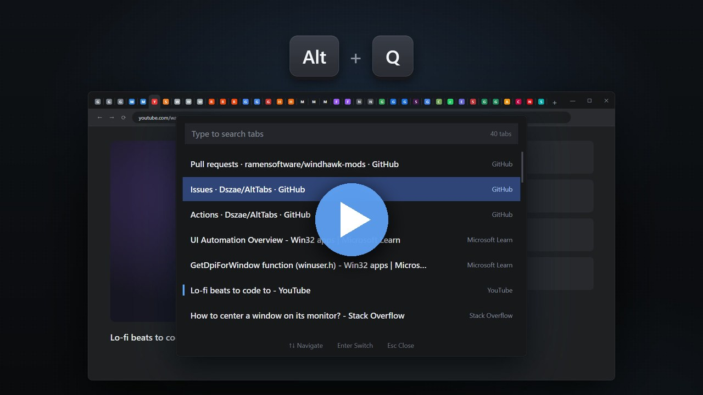
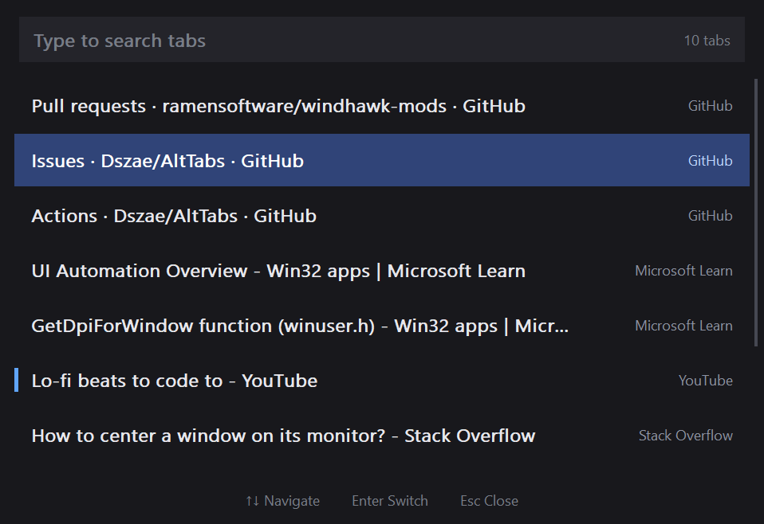
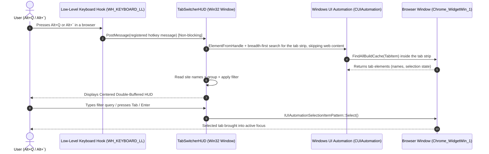

<div align="center">

# AltTabs

### Your browser tabs. One shortcut away.

A fast, lightweight, keyboard-driven floating tab switcher HUD for Chromium browsers on Windows.<br/>
Summon instantly with **`Alt + Q`** or **`Alt + ` `**, search in real time, and switch tabs without touching your mouse.

[](LICENSE)
[](https://microsoft.com/windows)
[](https://windhawk.net/mods/alttabs)
[](https://github.com/Dszae/AltTabs/actions)
[](https://isocpp.org/)

<br/>

<p align="center">
  <a href="assets/launch.mp4"></a><br/>
  <sub>▶️ <b><a href="assets/launch.mp4">Watch the 22-second video</a></b> • 📥 <b><a href="https://windhawk.net/mods/alttabs">Install from Windhawk</a></b></sub>
</p>

<br/>

[**Quick Install**](#-installation) • [**Keyboard Shortcuts**](#-keyboard-shortcuts) • [**Features**](#-features) • [**Architecture**](#-technical-architecture) • [**Troubleshooting**](#-troubleshooting--faq)

</div>

---

> [!NOTE]
> **AltTabs is an in-browser tab switcher HUD**, not a replacement for the Windows application Alt+Tab window switcher. It is designed specifically to solve tab overload inside Chromium browsers (**Brave**, **Google Chrome**, **Microsoft Edge**, and **Opera**) without injecting into Explorer or altering web pages.

---

## 🎯 The Problem & The Solution

### The Problem
Power users and developers frequently keep dozens of tabs open across research, documentation, pull requests, and communication tools.
- Modern Chromium browsers squish tabs into unreadable slivers once you pass 30+ tabs.
- Finding a specific tab requires either endless mouse clicking or opening separate history menus.
- Browser extensions designed for tab switching add DOM overhead, require broad browser permissions, and fail when browser focus is lost.

### The Solution: AltTabs
**AltTabs** runs as an isolated, native Win32 tool mod via [Windhawk](https://windhawk.net/). When you press **`Alt + Q`** or **`Alt + ` `**:
1. A sleek, centered dark HUD immediately floats over your active browser window.
2. It displays all open tabs of that window with their titles and the site name from the end of each title (`GitHub`, `YouTube`).
3. You can instantly filter the list by typing keywords or navigate with **`Tab`** / **`Arrow Keys`**.
4. Pressing **`Enter`** brings the target tab into view immediately.

<p align="center">
  
</p>

---

## ✨ Features

- **⚡ Instant Keyboard Activation**: Summon the switcher with **`Alt + Q`** or **`Alt + ` `** (the key above Tab on US layouts). The hotkeys are only taken over while a supported browser is focused, so other apps keep them.
- **🔍 Real-Time Filter**: Start typing to narrow down dozens of open tabs. Several words match tabs that contain all of them, in any order.
- **🏷️ Site Labels & Grouping**: Shows the site name from the end of each tab title (`GitHub`, `Stack Overflow`, `YouTube`) and can list the tabs of each site together. Browsers don't expose tab addresses to other apps, so the label comes from the title.
- **🎨 Windows 11 Fluent Aesthetics**: Uses DWM dark mode, rounded corners (`DWMWCP_ROUND`), ClearType Segoe UI typography, double-buffered GDI rendering, and scales with the display's DPI.
- **🔒 100% Offline & Private**: Zero telemetry, zero analytics, zero external network traffic. Everything executes strictly in local memory.
- **🪶 Zero Background Impact**: Uses a non-polling event model. Consumes **0% CPU** and **< 8 MB RAM** when idle.
- **🛡️ Clean Separation**: Runs inside an isolated Windhawk tool process. Does not inject hooks into `explorer.exe` or modify webpage DOM content.

---

## 📥 Installation

AltTabs is published in the official [Windhawk](https://windhawk.net/) mod catalog: **[windhawk.net/mods/alttabs](https://windhawk.net/mods/alttabs)**.

### Prerequisites
- Windows 10 (version 1809+) or Windows 11 (all versions).
- [Windhawk](https://windhawk.net/) installed (free, open-source).

---

### Install from the Windhawk Catalog (Recommended)

1. Open **Windhawk** and go to **Explore**.
2. Search for **AltTabs** and open **AltTabs - Browser Tab Switcher HUD**.
3. Click **Install**, then **Accept Risk and Install**.

Windhawk keeps the mod updated when new versions are published. If the mod doesn't show up in search, exit Windhawk from its tray icon and open it again so it downloads the latest catalog.

---

### Install as a Local Mod (Development Builds)

Use this to try changes from this repository before they reach the catalog. If you also have the catalog version installed, disable it first so that both don't run.

1. In Windhawk, click the **three dots menu (`···`)** $\rightarrow$ **Advanced Options** $\rightarrow$ **Create Local Mod** (or the **`+` New Mod** button).
2. Copy the entire content of [`alttabs.wh.cpp`](alttabs.wh.cpp) and paste it over the code in Windhawk's editor.
3. Press **`Ctrl + S`** (or click **Compile Mod**). Once compiled, the status shows **Loaded**.

You're done! Switch to your browser and press **`Alt + Q`**.

---

### Uninstallation
To disable or remove AltTabs:
1. Open Windhawk.
2. Find **AltTabs - Browser Tab Switcher HUD** on your home screen.
3. Click **Details** $\rightarrow$ toggle the switch to **Disabled**, or click **Uninstall**.

---

## 🎮 Keyboard Shortcuts

All controls are active whenever the AltTabs HUD is open:

| Shortcut | Action | Description |
| :--- | :--- | :--- |
| **`Alt + Q`** | **Summon / Cycle** | Summons the HUD over your browser, with the tab after the current one selected. Tap repeatedly to cycle tabs, add `Shift` to cycle backwards. |
| **`Alt + ` ` / `Alt + ~`** | **Alternative Summon** | Same as `Alt + Q`, using the key above Tab on US layouts. |
| **`Tab`** or **`↓ Down Arrow`** | **Next Tab** | Moves selection down by one row. |
| **`Shift + Tab`** or **`↑ Up Arrow`** | **Previous Tab** | Moves selection up by one row. |
| **`Page Down`** / **`Page Up`** | **Next / Previous Page** | Moves selection by one page of rows. |
| **Any Character Key (`a-z`, `0-9`)** | **Filter / Search** | Types directly into the search bar, filtering visible tabs instantly. |
| **`Backspace`** / **`Ctrl + Backspace`** | **Delete / Clear** | Removes the last typed character, or clears the filter. |
| **`Enter`** | **Activate Tab** | Switches to the selected tab and dismisses the HUD. |
| **Left Click** / **Mouse Wheel** | **Mouse Selection** | Click a row to switch to that tab, scroll the wheel to scroll the list. |
| **`Esc`** | **Dismiss** | Closes the HUD without changing the active tab. |

---

## 🌐 Browser Compatibility

AltTabs targets the standard Chromium Views accessibility tree (`Chrome_WidgetWin_1`).

| Browser | Status | Verification Details |
| :--- | :---: | :--- |
| **Brave Browser** | ✅ **Verified** | Fully tested and verified on Windows 11. Tab strip enumeration and selection verified. |
| **Google Chrome** | ✅ **Verified** | Tab strip enumeration verified (`TabContainer`). |
| **Microsoft Edge** | ✅ **Verified** | Tab strip enumeration verified (`EdgeTabStripRegionView`). |
| **Opera** | 🟡 **Untested** | Uses Chromium Views; community testing welcome. |
| **Vivaldi** | ❌ **Unsupported** | Vivaldi's tab bar is part of a web page, not a native tab strip. |
| **Mozilla Firefox** | ❌ **Unsupported** | Uses Gecko XUL rendering engine (`MozillaWindowClass`), not Chromium Views. |

---

## 🛠️ Technical Architecture

AltTabs is designed to adhere strictly to Windows system programming best practices:



### Key Engineering Decisions:
1. **Dedicated Process Tool Mod (`windhawk.exe -tool-mod`)**:
   Runs as a standalone tool process rather than injecting DLL code into `explorer.exe` or third-party web browsers. This eliminates Explorer stability risks.
2. **DLL Module Binding for Hooks**:
   The `WH_KEYBOARD_LL` hook is installed using `HINST_THISCOMPONENT` (`&__ImageBase`), ensuring the Windows hook manager accepts the hook procedure without rejecting `windhawk.exe` as an invalid module.
3. **Separate Hook and UI Automation Threads**:
   The `WH_KEYBOARD_LL` hook runs on its own thread that does nothing else, so typing anywhere in Windows is never delayed by UI Automation calls. The HUD and all UIA work live on a second thread with `CoInitializeEx(nullptr, COINIT_APARTMENTTHREADED)`, and UIA calls time out after 2 seconds if a browser hangs.
4. **Native Tab Strip Only**:
   Tabs are read from the browser's own tab strip, found with a breadth-first search that never descends into web page content. Tab-like widgets inside web pages (ARIA `role="tab"`) aren't listed, and pages aren't crawled.
5. **Window Activation**:
   Tab activation uses `IUIAutomationSelectionItemPattern::Select()`, with `IUIAutomationLegacyIAccessiblePattern::DoDefaultAction()` as a fallback.
6. **Accessibility Warm-Up**:
   Chromium builds its accessibility tree on the first request, so right after a browser starts, AltTabs retries the tab strip lookup a couple of times before showing "No tabs found".

---

## 🔒 Privacy & Security

We believe system utilities should be completely transparent:
- **No Network Permissions**: AltTabs makes zero outbound HTTP/HTTPS requests and has no network sockets open.
- **No Telemetry**: No tracking, usage analytics, or error reporting is transmitted.
- **No Page DOM Access**: AltTabs operates strictly at the desktop window accessibility level (`UIA_TabItemControlTypeId`). It never reads webpage content, passwords, forms, or cookies.
- **Open Source Auditable**: The entire codebase is self-contained in a single readable source file: [`alttabs.wh.cpp`](alttabs.wh.cpp).

---

## ⚡ Performance Verification

AltTabs is built for zero perceptible latency:

- **Idle Resource Usage**: 0.0% CPU, < 8 MB private working set.
- **Activation Latency**: Reading the tab strip takes about 30-100 ms in Brave, Chrome and Edge.

### How to Verify Locally:
1. Open **Windhawk** and navigate to the **AltTabs** mod page.
2. Click the **Log** tab to view the enumeration logs generated via `Wh_Log`:
   ```text
   Found 24 tabs
   ```
3. Open **Windows Task Manager** $\rightarrow$ **Details**, locate the `windhawk.exe` process with command-line `-tool-mod "alttabs"`, and observe memory and CPU remain at 0% when idle.

---

## 🗺️ Roadmap

- [x] **v1.1.0**: Standalone floating HUD with Win32 rounded corners & dark mode.
- [x] **v1.1.1**: Dual universal hotkeys (`Alt + Q` and `Alt + ` `), COM apartment fixes, and guaranteed fallback display.
- [x] **v1.2.0**: Native tab strip only, separate hook thread, site grouping, scrolling, DPI scaling, and browser-only hotkeys.
- [ ] **v1.3.0**: User-configurable hotkey selector in Windhawk mod settings UI.
- [ ] **v1.4.0**: Favicon rendering.
- [ ] **v1.5.0**: Multi-window tab switching (switch across all open browser windows simultaneously).

---

## 🤝 Contributing

Contributions are warmly welcomed! Please read [CONTRIBUTING.md](CONTRIBUTING.md) for details on setting up your environment and submitting changes.

### Local Development Workflow:
1. Fork this repository and clone your fork:
   ```bash
   git clone https://github.com/<your-username>/AltTabs.git
   ```
2. Open Windhawk $\rightarrow$ **Advanced Options** $\rightarrow$ **Create Local Mod**.
3. Edit [`alttabs.wh.cpp`](alttabs.wh.cpp) in your editor of choice (e.g., VS Code).
4. Paste and test your changes in Windhawk.
5. Submit a Pull Request targeting the `main` branch.

---

## ❓ Troubleshooting & FAQ

<details>
<summary><b>Why <code>Alt + Q</code> instead of <code>Alt + Tab</code>?</b></summary>
Windows 11's Alt-Tab switcher is controlled by <code>XamlExplorerHost.exe</code>, which tightly couples the taskbar with the Alt-Tab list. Modifying it causes unwanted ghost windows or taskbar flickering. A dedicated floating HUD triggered by <code>Alt + Q</code> provides instantaneous response, custom real-time search, domain grouping, and zero interference with native Windows multitasking.
</details>

<details>
<summary><b>Nothing happens when I press <code>Alt + Q</code>. What should I check?</b></summary>
1. Verify the mod status in Windhawk displays <b>Loaded</b>.<br/>
2. Ensure an active Chromium browser window (Brave, Chrome, Edge) is currently open and focused.<br/>
3. Open the <b>Log</b> tab in Windhawk to verify that the worker thread and hook initialized successfully.
</details>

<details>
<summary><b>Can I change the keyboard shortcut?</b></summary>
Yes. In <code>alttabs.wh.cpp</code>, locate <code>IsHotkey</code> and adjust the virtual key code (e.g., replace <code>'Q'</code> with your preferred key). A GUI setting for hotkey configuration is planned in an upcoming release.
</details>

<details>
<summary><b>Does this work with vertical tabs in Brave or Edge?</b></summary>
It should, since the tabs are found by their UI Automation control type rather than their position, but vertical tabs haven't been tested yet. Reports are welcome.
</details>

---

## 📄 License & Acknowledgements

- **License**: Released under the open-source [MIT License](LICENSE).
- **Acknowledgements**: Built on the open-source [Windhawk](https://windhawk.net/) framework developed by [Ramen Software](https://github.com/ramensoftware).

## Author

Built by **Dipesh Sapkota** ([@Dszae](https://github.com/Dszae)), a Computer Engineering student at IOE Thapathali Campus, Kathmandu, Nepal. More projects at [dipeshsapkota7.com.np](https://www.dipeshsapkota7.com.np/).
