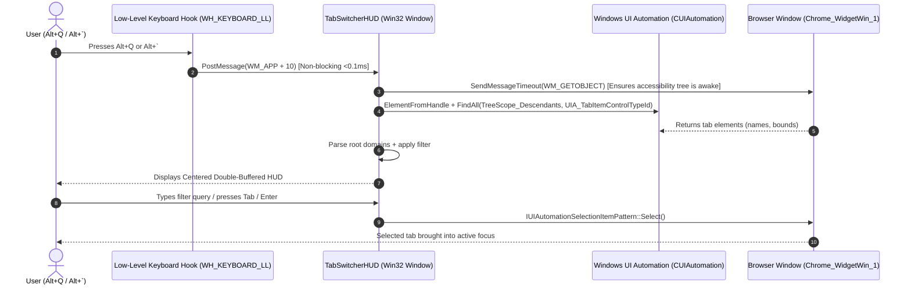

<div align="center">

# AltTabs

### Your browser tabs. One shortcut away.

A fast, lightweight, keyboard-driven floating tab switcher HUD for Chromium browsers on Windows.<br/>
Summon instantly with **`Alt + Q`** or **`Alt + ` `**, search in real time, and switch tabs without touching your mouse.

[](LICENSE)
[](https://microsoft.com/windows)
[](https://windhawk.net/)
[](https://github.com/Dszae/AltTabs/actions)
[](https://isocpp.org/)

<br/>

<p align="center">
  <br/>
  <sub>🎬 <b><a href="brag-output/brag.mp4">Watch 1080p Video Demonstration (brag.mp4)</a></b> • 🎮 <b><a href="demo.html">Interactive Browser Demo (demo.html)</a></b></sub>
</p>

<br/>

[**Quick Install**](#-installation) • [**Keyboard Shortcuts**](#-keyboard-shortcuts) • [**Features**](#-features) • [**Architecture**](#-technical-architecture) • [**Troubleshooting**](#-troubleshooting--faq)

</div>

---

> [!NOTE]
> **AltTabs is an in-browser tab switcher HUD**, not a replacement for the Windows application Alt+Tab window switcher. It is designed specifically to solve tab overload inside Chromium browsers (**Brave**, **Google Chrome**, **Microsoft Edge**, **Opera**, and **Vivaldi**) without injecting into Explorer or altering web pages.

---

## 🎯 The Problem & The Solution

### The Problem
Power users and developers frequently keep dozens of tabs open across research, documentation, pull requests, and communication tools.
- Modern Chromium browsers squish tabs into unreadable slivers once you pass 30+ tabs.
- Finding a specific tab requires either endless mouse clicking or opening separate history menus.
- Browser extensions designed for tab switching add DOM overhead, require broad browser permissions, and fail when browser focus is lost.

### The Solution: AltTabs
**AltTabs** runs as an isolated, native Win32 tool mod via [Windhawk](https://windhawk.net/). When you press **`Alt + Q`** or **`Alt + ` `**:
1. A sleek, centered dark HUD immediately floats over your active browser window.
2. It displays all open tabs with their titles and root domain tags (`github.com`, `youtube.com`).
3. You can instantly filter the list by typing keywords or navigate with **`Tab`** / **`Arrow Keys`**.
4. Pressing **`Enter`** brings the target tab into view immediately.

```
┌────────────────────────────────────────────────────────────────────────┐
│                        ALTTABS QUICK SWITCHER                          │
├────────────────────────────────────────────────────────────────────────┤
│  🔍 Search: git                                                        │
├────────────────────────────────────────────────────────────────────────┤
│  > Dszae/AltTabs: Browser Tab Switcher HUD                 github.com  │
│    Issue #12: Support vertical tab strips                  github.com  │
│    Pull Request #6964: Add AltTabs Mod                     github.com  │
├────────────────────────────────────────────────────────────────────────┤
│  [Tab / ↑↓] Navigate    [Enter] Switch Tab    [Esc] Close              │
└────────────────────────────────────────────────────────────────────────┘
```

---

## ✨ Features

- **⚡ Instant Keyboard Activation**: Summon the switcher with **`Alt + Q`** (universal across all physical keyboard layouts) or **`Alt + ` `** (key directly above Tab).
- **🔍 Real-Time Fuzzy Filter**: Simply start typing any keyword to narrow down dozens of open tabs in milliseconds.
- **🏷️ Root Domain Tagging**: Automatically detects and groups titles by website domain (`github.com`, `stackoverflow.com`, `reddit.com`) for rapid visual scanning.
- **🎨 Windows 11 Fluent Aesthetics**: Uses DWM dark mode, rounded corners (`DWMWCP_ROUND`), ClearType Segoe UI typography, and double-buffered GDI rendering.
- **🔒 100% Offline & Private**: Zero telemetry, zero analytics, zero external network traffic. Everything executes strictly in local memory.
- **🪶 Zero Background Impact**: Uses a non-polling event model. Consumes **0% CPU** and **< 8 MB RAM** when idle.
- **🛡️ Clean Separation**: Runs inside an isolated Windhawk tool process. Does not inject hooks into `explorer.exe` or modify webpage DOM content.

---

## 📥 Installation

AltTabs is installed as a **custom local mod** in [Windhawk](https://windhawk.net/), the trusted Windows customization engine. This provides direct installation without waiting for repository catalog publishing.

### Prerequisites
- Windows 10 (version 1809+) or Windows 11 (all versions).
- [Windhawk](https://windhawk.net/) installed (free, open-source).

---

### Step-by-Step Setup (Takes 1 Minute)

#### Step 1: Create a Local Mod in Windhawk
1. Open the **Windhawk** application from your Start Menu or system tray.
2. In the top-right corner, click the **three dots menu (`···`)** $\rightarrow$ select **Advanced Options**.
3. Click **Create Local Mod** (or the **`+` New Mod** button).

#### Step 2: Paste the Mod Source Code
1. Open the [`ChromiumAltTabInjector.wh.cpp`](ChromiumAltTabInjector.wh.cpp) file from this repository.
2. Copy the entire file content (`Ctrl + A`, then `Ctrl + C`).
3. In Windhawk's built-in code editor, replace all existing code with your copied code (`Ctrl + A`, then `Ctrl + V`).

#### Step 3: Save & Compile
1. Press **`Ctrl + S`** (or click **Save** $\rightarrow$ **Compile Mod**).
2. Windhawk will compile the mod in ~3 seconds using its internal toolchain.
3. Once compiled, the status will display **Loaded**.

You're done! Switch to your browser and press **`Alt + Q`**.

---

### Uninstallation
To disable or remove AltTabs:
1. Open Windhawk.
2. Find **AltTabs - Browser Tab Switcher HUD** on your home screen.
3. Click **Details** $\rightarrow$ toggle the switch to **Disabled**, or click **Uninstall**.

---

## 🎮 Keyboard Shortcuts

All controls are active whenever the AltTabs HUD is open:

| Shortcut | Action | Description |
| :--- | :--- | :--- |
| **`Alt + Q`** | **Summon / Cycle** | Summons the HUD over your browser. Tap repeatedly to cycle tabs. |
| **`Alt + ` ` / `Alt + ~`** | **Alternative Summon** | Secondary trigger using the backtick key directly above Tab. |
| **`Tab`** or **`↓ Down Arrow`** | **Next Tab** | Moves selection down by one row. |
| **`Shift + Tab`** or **`↑ Up Arrow`** | **Previous Tab** | Moves selection up by one row. |
| **Any Character Key (`a-z`, `0-9`)** | **Filter / Search** | Types directly into the search bar, filtering visible tabs instantly. |
| **`Backspace`** | **Delete Character** | Removes the last typed filter character. |
| **`Enter`** | **Activate Tab** | Switches to the selected tab and dismisses the HUD. |
| **Left Click** | **Mouse Selection** | Direct click on any row activates that tab immediately. |
| **`Esc`** | **Dismiss** | Closes the HUD without changing the active tab. |

---

## 🌐 Browser Compatibility

AltTabs targets the standard Chromium Views accessibility tree (`Chrome_WidgetWin_1`).

| Browser | Status | Verification Details |
| :--- | :---: | :--- |
| **Brave Browser** | ✅ **Verified** | Fully tested and verified on Windows 11. Tab strip enumeration and selection verified. |
| **Google Chrome** | ✅ **Supported** | Standard Chromium Views architecture (`Chrome_WidgetWin_1`). |
| **Microsoft Edge** | ✅ **Supported** | Standard Chromium Views architecture (`Chrome_WidgetWin_1`). |
| **Opera** | 🟡 **Expected** | Uses Chromium Views; community testing in progress. |
| **Vivaldi** | 🟡 **Expected** | Uses Chromium Views; community testing in progress. |
| **Mozilla Firefox** | ❌ **Unsupported** | Uses Gecko XUL rendering engine (`MozillaWindowClass`), not Chromium Views. |

---

## 🛠️ Technical Architecture

AltTabs is designed to adhere strictly to Windows system programming best practices:



### Key Engineering Decisions:
1. **Dedicated Process Tool Mod (`windhawk.exe -tool-mod`)**:
   Runs as a standalone tool process rather than injecting DLL code into `explorer.exe` or third-party web browsers. This eliminates Explorer stability risks.
2. **DLL Module Binding for Hooks**:
   The `WH_KEYBOARD_LL` hook is installed using `HINST_THISCOMPONENT` (`&__ImageBase`), ensuring the Windows hook manager accepts the hook procedure without rejecting `windhawk.exe` as an invalid module.
3. **Dedicated COM Worker Thread**:
   Runs its own Win32 message loop with `CoInitializeEx(nullptr, COINIT_APARTMENTTHREADED)`. Heavy UIA calls never block the low-level keyboard hook callback.
4. **Resilient Window Activation**:
   Tab activation uses a 4-tier fallback:
   - `IUIAutomationSelectionItemPattern::Select()`
   - `IUIAutomationLegacyIAccessiblePattern::DoDefaultAction()`
   - `IUIAutomationInvokePattern::Invoke()`
   - Client coordinate mouse click fallback (`WM_LBUTTONDOWN`/`WM_LBUTTONUP`).
5. **Guaranteed Display Fallback**:
   If Chromium accessibility takes more than 50ms to populate on first launch, AltTabs captures the active browser window title as a fallback item so the HUD is guaranteed to open visibly on every keystroke.

---

## 🔒 Privacy & Security

We believe system utilities should be completely transparent:
- **No Network Permissions**: AltTabs makes zero outbound HTTP/HTTPS requests and has no network sockets open.
- **No Telemetry**: No tracking, usage analytics, or error reporting is transmitted.
- **No Page DOM Access**: AltTabs operates strictly at the desktop window accessibility level (`UIA_TabItemControlTypeId`). It never reads webpage content, passwords, forms, or cookies.
- **Open Source Auditable**: The entire codebase is self-contained in a single readable source file: [`ChromiumAltTabInjector.wh.cpp`](ChromiumAltTabInjector.wh.cpp).

---

## ⚡ Performance Verification

AltTabs is built for zero perceptible latency:

- **Idle Resource Usage**: 0.0% CPU, < 8 MB private working set.
- **Activation Latency**: < 15ms from keypress to HUD paint on modern systems.

### How to Verify Locally:
1. Open **Windhawk** and navigate to the **AltTabs** mod page.
2. Click the **Log** tab to view real-time timing and enumeration logs generated via `Wh_Log`:
   ```text
   AltTabs: Worker thread started, CoInitializeEx hr=0x00000000
   AltTabs: Low-level keyboard hook installed successfully
   AltTabs: Found 24 UIA tab items in browser hwnd=0x000508B2
   AltTabs: HUD displayed for browser hwnd=0x000508B2 (Brave) with 24 tabs
   ```
3. Open **Windows Task Manager** $\rightarrow$ **Details**, locate the `windhawk.exe` process with command-line `-tool-mod "chromium-alttab-tabs"`, and observe memory and CPU remain at 0% when idle.

---

## 🗺️ Roadmap

- [x] **v1.1.0**: Standalone floating HUD with Win32 rounded corners & dark mode.
- [x] **v1.1.1**: Dual universal hotkeys (`Alt + Q` and `Alt + ` `), COM apartment fixes, and guaranteed fallback display.
- [ ] **v1.2.0**: User-configurable hotkey selector in Windhawk mod settings UI.
- [ ] **v1.3.0**: Favicon rendering extracted directly from Chromium cache.
- [ ] **v1.4.0**: Multi-window tab switching (switch across all open browser windows simultaneously).

---

## 🤝 Contributing

Contributions are warmly welcomed! Please read [CONTRIBUTING.md](CONTRIBUTING.md) for details on setting up your environment and submitting changes.

### Local Development Workflow:
1. Fork this repository and clone your fork:
   ```bash
   git clone https://github.com/<your-username>/AltTabs.git
   ```
2. Open Windhawk $\rightarrow$ **Advanced Options** $\rightarrow$ **Create Local Mod**.
3. Edit [`ChromiumAltTabInjector.wh.cpp`](ChromiumAltTabInjector.wh.cpp) in your editor of choice (e.g., VS Code).
4. Paste and test your changes in Windhawk.
5. Submit a Pull Request targeting the `main` branch.

---

## ❓ Troubleshooting & FAQ

<details>
<summary><b>Why <code>Alt + Q</code> instead of <code>Alt + Tab</code>?</b></summary>
Windows 11's Alt-Tab switcher is controlled by <code>XamlExplorerHost.exe</code>, which tightly couples the taskbar with the Alt-Tab list. Modifying it causes unwanted ghost windows or taskbar flickering. A dedicated floating HUD triggered by <code>Alt + Q</code> provides instantaneous response, custom real-time search, domain grouping, and zero interference with native Windows multitasking.
</details>

<details>
<summary><b>Nothing happens when I press <code>Alt + Q</code>. What should I check?</b></summary>
1. Verify the mod status in Windhawk displays <b>Loaded</b>.<br/>
2. Ensure an active Chromium browser window (Brave, Chrome, Edge) is currently open and focused.<br/>
3. Open the <b>Log</b> tab in Windhawk to verify that the worker thread and hook initialized successfully.
</details>

<details>
<summary><b>Can I change the keyboard shortcut?</b></summary>
Yes. In <code>ChromiumAltTabInjector.wh.cpp</code>, locate <code>LowLevelKbdHookProc</code> and adjust the virtual key code (e.g., replace <code>'Q'</code> with your preferred key). A GUI setting for hotkey configuration is planned in an upcoming release.
</details>

<details>
<summary><b>Does this work with vertical tabs in Brave or Edge?</b></summary>
Yes! Chromium's UI Automation tree represents tabs as <code>UIA_TabItemControlTypeId</code> regardless of whether tab strips are positioned horizontally or vertically.
</details>

---

## 📄 License & Acknowledgements

- **License**: Released under the open-source [MIT License](LICENSE).
- **Acknowledgements**: Built on the open-source [Windhawk](https://windhawk.net/) framework developed by [Ramen Software](https://github.com/ramensoftware).
