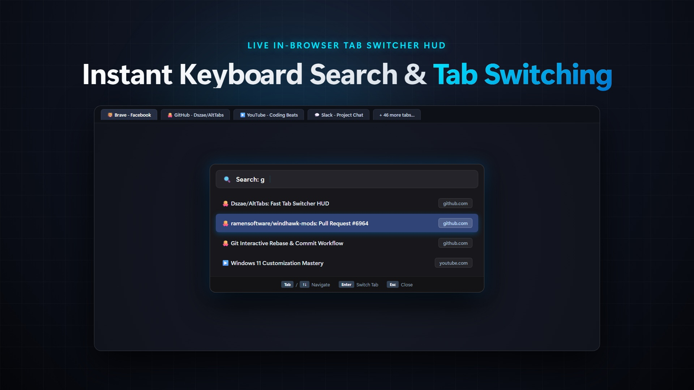
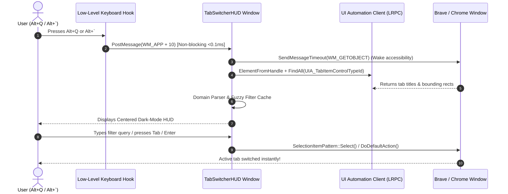

<div align="center">

# ⚡ AltTabs

### Fast, Sleek Tab Switcher HUD for Brave, Chrome, Edge & Chromium Browsers

[](https://github.com/Dszae/AltTabs/stargazers)
[](LICENSE)
[](https://microsoft.com/windows)
[](https://windhawk.net/)
[](https://isocpp.org/)

<p align="center">
  <b>Tired of hunting through 50 open tabs in Brave or Chrome?</b><br/>
  <b>AltTabs brings a dedicated, lightning-fast floating Tab Switcher HUD to your browser.<br/>
  Summon it instantly with <code>Alt + Q</code> or <code>Alt + `</code>, filter in real-time, and switch with zero lag.</b>
</p>

<p align="center">
  <br/>
  <i>🎬 <b><a href="brag-output/brag.mp4">Watch 1080p Launch Video (brag.mp4)</a></b> • 🎮 <b><a href="demo.html">Try Interactive Switcher Demo (demo.html)</a></b></i>
</p>

[**📥 Manual Install Guide (3 Steps)**](#-manual-install-guide-takes-1-minute) • [**🎮 Keyboard Controls**](#-keyboard-controls) • [**✨ Features**](#-features) • [**🛠️ How It Works**](#-how-it-works) • [**FAQ**](#-faq)

---

</div>

## 💥 The Problem

Multitasking with modern browsers is frustrating:
- In **Google Chrome** and **Brave**, tabs do **not** appear in Windows Alt-Tab or have a unified quick switcher.
- When you have 40+ tabs open, tab titles shrink into microscopic slivers. You waste seconds clicking back and forth trying to find that one YouTube tutorial or GitHub PR.
- Third-party extensions slow down page rendering, ask for broad browser permissions, and stop working when focus is lost.

## 🚀 The Solution: AltTabs

**AltTabs** runs as a lightweight, native Win32 tool mod via Windhawk. It hooks directly into Windows and Chromium's UI Automation tree, giving you an instantaneous, keyboard-driven switcher that floats right over your active browser.

```
┌────────────────────────────────────────────────────────────────────────┐
│                        ALTTABS QUICK SWITCHER                          │
├────────────────────────────────────────────────────────────────────────┤
│  🔍 Search: git                                                        │
├────────────────────────────────────────────────────────────────────────┤
│  > Dszae/AltTabs: Browser Tab Switcher HUD                 github.com  │
│    Issue #12: Support vertical tab strips                  github.com  │
│    Pull Request #6964: Add AltTabs Mod                     github.com  │
├────────────────────────────────────────────────────────────────────────┤
│  [Tab / ↑↓] Navigate    [Enter] Switch Tab    [Esc] Close              │
└────────────────────────────────────────────────────────────────────────┘
```

---

## 📥 Manual Install Guide (Takes 1 Minute)

You can run AltTabs directly as a **custom local mod** in Windhawk with zero waiting for app store approvals.

### Prerequisites
1. Download and install **[Windhawk](https://windhawk.net/)** (the popular, open-source Windows customization engine).

---

### Step 1: Create a Local Mod in Windhawk
1. Open the **Windhawk** application.
2. In the top-right corner, click on the **three dots menu (`···`)** or **Details** $\rightarrow$ select **Advanced Options**.
3. Click on **Create Local Mod** (or the **`+` New Mod** button).

---

### Step 2: Paste the Mod Code
1. Open [`ChromiumAltTabInjector.wh.cpp`](ChromiumAltTabInjector.wh.cpp) in this repository.
2. Copy the entire file contents (`Ctrl + A`, then `Ctrl + C`).
3. In the Windhawk Mod Editor, select all existing boilerplate code (`Ctrl + A`) and paste the copied code (`Ctrl + V`).

---

### Step 3: Save and Compile
1. Click **Save** and then click **Compile Mod** (or simply press `Ctrl + S`).
2. Windhawk will compile the mod in a few seconds. Once compiled, you will see the status change to **Loaded**.
3. **You're all done!** 🎉

---

## 🎮 Keyboard Controls

Switch to your browser (**Brave**, **Chrome**, **Edge**, **Opera**, or **Vivaldi**) and use these shortcuts:

| Shortcut | Action |
| :--- | :--- |
| **`Alt + Q`** or **`Alt + ` `** | **Summon the HUD** (press repeatedly to cycle through tabs) |
| **`Tab`** or **`↓ Down Arrow`** | Move down to the next tab |
| **`Shift + Tab`** or **`↑ Up Arrow`** | Move up to the previous tab |
| **Just start typing** (`e.g., git, face, you`) | **Instant fuzzy search** — filters tabs in real time |
| **`Enter`** or **Mouse Click** | **Switch to the selected tab** immediately |
| **`Esc`** | Close the switcher HUD |

---

## ✨ Features

- 🎯 **Universal Chromium Support**: Works natively with **Brave**, **Google Chrome**, **Microsoft Edge**, **Opera**, and **Vivaldi**.
- 🔍 **Real-Time Fuzzy Filter**: Simply type any keyword (`"docs"`, `"pull"`, `"music"`) to filter 100+ open tabs instantly.
- 🗂️ **Domain Badge Tagging**: Automatically detects and tags root domains (`github.com`, `youtube.com`, `facebook.com`) so your tabs are cleanly organized.
- 🎨 **Native Windows 11 Styling**: Smooth rounded corners, dark mode acrylic theme, ClearType typography, and zero background clutter.
- ⚡ **Zero Browser Lag**: Queries Chromium's UI Automation tree directly using native Win32 LRPC without injecting into Chrome renderers or modifying web pages.
- 🔒 **100% Offline & Private**: Zero internet access, zero telemetry, zero background network calls. Runs completely in local memory.
- 🪶 **Ultra-Low Resource Footprint**: Consumes **< 8 MB RAM** and **0% CPU** when idle.

---

## 🛠️ How It Works

AltTabs runs in an isolated dedicated tool process powered by Windhawk:



---

## ⚙️ Mod Settings

You can customize AltTabs right from the Windhawk Mod settings tab:

```yaml
GroupByDomain: true   # Displays domain chips next to each tab title
EnableBrave: true     # Support Brave Browser
EnableChrome: true    # Support Google Chrome
EnableEdge: true      # Support Microsoft Edge
EnableOpera: true     # Support Opera Browser
EnableVivaldi: true   # Support Vivaldi Browser
```

---

## ❓ FAQ

<details>
<summary><b>Why install manually as a local mod?</b></summary>
Installing as a local mod gives you total control: you get instant access without waiting for third-party catalog reviews, and you can tweak the code, hotkeys, or themes anytime directly in Windhawk!
</details>

<details>
<summary><b>Does this slow down my browser or drain battery?</b></summary>
Not at all. AltTabs only queries the browser's top-level tab strip control (<code>Chrome_WidgetWin_1</code>) when you actively press <code>Alt + Q</code>. It doesn't run continuous polling loops and uses 0% CPU while idle.
</details>

<details>
<summary><b>Can I change the hotkey?</b></summary>
Yes! By default, both <b><code>Alt + Q</code></b> (universal on all laptop and desktop keyboards) and <b><code>Alt + `</code></b> (the key above Tab) work simultaneously. You can change the key codes inside <code>LowLevelKbdHookProc</code> in the code anytime.
</details>

---

## 🌟 Support & Contributions

If you find AltTabs helpful, please **star the repository** ⭐! It helps others discover the project.

Pull requests, bug reports, and suggestions are welcome via [GitHub Issues](https://github.com/Dszae/AltTabs/issues).

---

## 📄 License

This project is open-source under the [MIT License](LICENSE).
